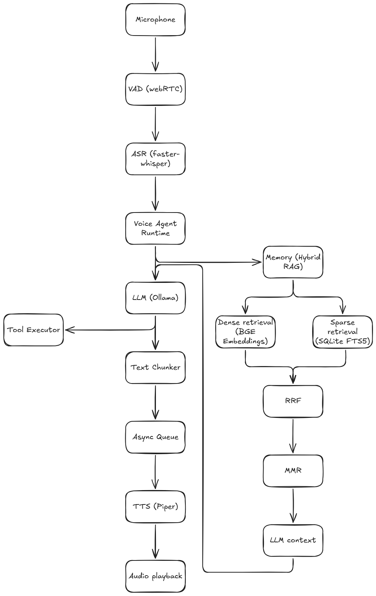
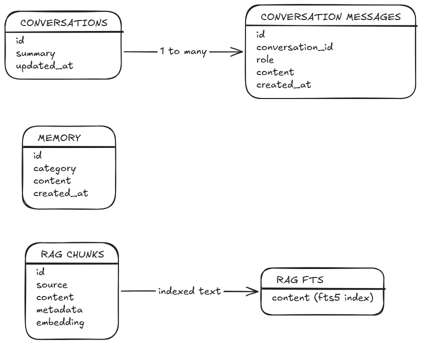

# RUNE

Personal AI Voice Assistant

RUNE (Real-time Unified Neural Entity) is a local-first personal AI voice assistant. It listens through the microphone, converts speech to text, sends the request to a local LLM, and speaks the response back. It also supports tool execution, conversation history, long-term memory, and retrieval from a local knowledge base.

## Features

- Voice input with WebRTC VAD for speech detection and turn handling
- STT using Faster-Whisper
- Local LLM responses through Ollama, with streaming token output
- TTS using Piper, with interruptible audio playback (i.e, barge-in)
- Asynchronous generation and playback using a bounded producer-consumer queue
- Persistent conversation history state management
- Long-term memory stored in SQLite
- Hybrid RAG using BGE embeddings + SQLite FTS5/BM25 + RRF + sMMR
- Structured tool calling
- Basic latency benchmarking

## Tech stack

- Python
- Ollama = `qwen3:0.6b`
- Faster-Whisper
- WebRTC VAD
- Piper TTS
- FastEmbed = `BAAI/bge-small-en-v1.5`
- SQLite + FTS5
- NumPy, SoundDevice, HTTPX
- pytest

## Architecture

The live runtime is started from `app/live_voice_agent.py`



## Database Design

The application uses one SQLite database at `data/voice_agent.db`. It is created automatically when the stores are initialized.



The RAG index is stored locally in the same database. Rebuilding or deleting indexed sources changes this data.

## Running the project

Runs on python & ollama

```bash
pip install -r requirements.txt
```

Install and start Ollama, then pull the configured model -> 

```bash
ollama pull qwen3:0.6b
```

Place the Piper voice model at -> 

`models/en_US-kusal-medium.onnx`

Start the assistant from root ->

```bash
python -m app.live_voice_agent
```

Say "exit" or "quit" to stop the assistant

The first run may take longer while local models are downloaded or initialized

## Tests

```bash
pytest
```
or
```bash
python -m tests.test_*.py
```

## TODO

- Improve config so model names, paths, timeouts, and audio settings are managed in one place
- Add more robust handling -> for Ollama disconnects, request timeouts, and failed tool calls
- Add retrieval evaluation datasets + track recall@K, MRR, nDCG, and retrieval latency
- Consider an ANN index like HNSW
- Add tests for longer conversations + concurrent sessions + repeated interruptions
- Improve partial transcription + VAD turn-end detection
- Add a simple interface for managing sessions, memories, and knowledge sources
